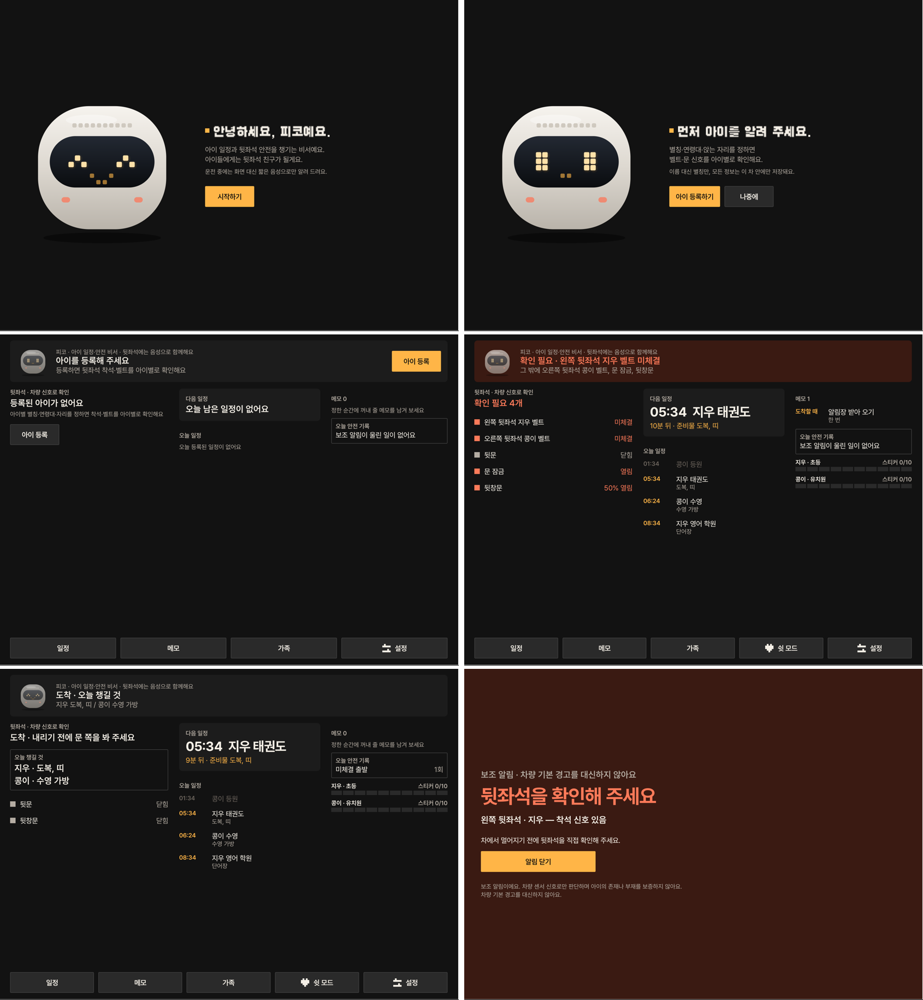

# 피코 드라이브 (Piko Drive)

**아이를 태우는 부모에게는 일정·안전 비서, 뒷좌석 아이에게는 친구.**
차량의 착석·벨트·문·잠금 신호와 기어 상태를 아이의 하루 일정과 연결해, 부모가 아무것도 누르지 않아도 탑승부터 하차까지 챙기는 Pleos Connect 앱입니다.



> 현대자동차그룹 차량용 앱 개발 공모전 출품작. 캐릭터·UI는 독자 디자인이며 공식 제휴·승인과 무관합니다.

## 핵심 동작
| 상황 | 운전석 화면 (부모) | 뒷좌석 (아이) |
|---|---|---|
| 정차 (P) | 맨 위 '지금 할 일' 한 줄 + 뒷좌석 체크 · 오늘 일정 · 상황 메모 · 안전 기록, 일정·메모·가족 입력 | 피코 얼굴과 말풍선, 스티커판 |
| 주행 (D) | 피코 얼굴만 (텍스트·버튼 0), 알림은 짧은 음성 | 피코 (뒷좌석 화면이 있을 때) |
| 후진 (R) | 정지 화면, 무음 | |

- **뒷좌석 자동 확인**: 아이별 착석·벨트, 뒷문, 문 잠금, 뒷창문 → 출발 전 요약. 벨트 미체결로 출발·주행 중 벨트 풀림·차도 쪽 뒷문 열림은 운전자에게 음성.
- **뒷좌석 남김 보조 알림**: 함께 달린 뒤 운전석이 비었거나 정차 중 문을 잠갔는데 뒷좌석 착석 신호가 남으면 반복 알림. 센서를 못 읽으면 "확인 불가". 차량 기본 경고를 대신하지 않습니다.
- **일정·상황 메모**: 일정이 다가오면 브리핑, 도착하면 그 무렵 일정의 준비물. 메모는 탈 때·출발할 때·도착할 때·내릴 때·정한 시각에 꺼냅니다.
- **뒷좌석 친구 피코**: 연령대별 말투(중고등은 기본 꺼짐), 신호로 확인되는 행동에만 스티커, 이마의 빛 10칸 = 스티커판.
- **쉿 모드**(대사 끄기 + 앰비언트 조명 낮춤), **보호자 알림**(별칭·좌석·시각만, 켤 때만. 현재는 웹훅 시연, 푸시·계정은 후속).
- **입력**: 칩으로 고르거나 정차 중 말로 ("수요일 오후 3시 태권도"), 저장 전 요약 문장으로 확인.

## 사용 Pleos / 차량 API
| API | 용도 |
|---|---|
| **Pleos Vehicle SDK** `ai.pleos.playground:Vehicle:2.3.2` | 뒷좌석·운전석 착석, 벨트, 뒷문 위치, 문 잠금, 뒷창문, 실내 온도, 앰비언트 조명(쓰기), 기어, 배터리 |
| **Pleos TextToSpeech** `ai.pleos.playground:TextToSpeech:3.3.1` | 차량 내 한국어 음성 |
| **Pleos SpeechToText** `ai.pleos.playground:SpeechToText:3.3.1` (ON_DEVICE) | 정차 중 말로 입력 |
| AAOS Car API | 속도, UX 제한, 탑승자 구역(뒷좌석 디스플레이 탐색) |

신호별 실측 결과와 한계는 [`qa/EVIDENCE.md`](qa/EVIDENCE.md).

## 실행 방법
> 검증된 실행 환경은 **Pleos Connect Emulator v2.1.0**입니다. 일반 Android 기기에서는 내장 시뮬레이터(SIM 모드)로 동작합니다.

### 1. APK 설치·실행
```bash
adb uninstall com.pikodrive || true
adb install apk/*_release.apk
adb shell pm grant --user current com.pikodrive android.car.permission.CAR_SPEED || true
```
앱 목록에서 **피코 드라이브** 실행 → "시작하기" → "아이 등록하기"(또는 "나중에"). 마이크 권한은 "말로 입력"을 처음 누를 때 묻습니다.

### 2. 차량 데이터 넣기 (Virtual Console)
```bash
adb forward tcp:18088 tcp:8088          # 브라우저로도 조작 가능: http://127.0.0.1:18088
python3 tools/vconsole.py gear Drive
python3 tools/vconsole.py speed 40
```
뒷좌석 착석·문·잠금·창문은 콘솔의 Seat·Body 항목(또는 `tools/vconsole.py`의 `seat`·`door`·`lock`·`window`)으로 넣습니다. 벨트는 콘솔에 주입 경로가 없어, 시연할 때 숨은 데모 패널의 "벨트 · 시뮬레이션 입력"을 씁니다.

### 3. 시연 재현 (시연·심사용 기능)
정차 홈에서 **"피코 · 아이 일정·안전 비서" 글자를 5번 빠르게 탭** → 데모 패널(시연용) → "데모 가족·일정 불러오기". 화면에 "시뮬레이션 입력" 배지가 붙습니다.
전체 루틴 자동 재생은 디버그 빌드에서 (벨트 대체 입력 훅이 디버그에만 있음):
```bash
./gradlew :app:assembleDebug && adb install -r -g app/build/outputs/apk/debug/app-debug.apk
python3 tools/v3_kidride.py out/kidride     # 탑승→벨트→출발 경고→도착 준비물→차도 쪽 문→남김, 보호자 알림 포함
python3 tools/v5_voice.py out/input         # 칩 입력 + 말로 입력(합성 음성 주입)
python3 tools/guardian_server.py            # 보호자 화면 http://127.0.0.1:8099 (adb reverse tcp:8099 tcp:8099)
```

### 4. 소스에서 빌드
```bash
./gradlew :core:test             # 코어 단위 테스트 135개 (루틴 판단·일정·메모·음성 해석·발화 정책)
./gradlew :app:assembleRelease   # 서명 키가 없으면 debug 키로 서명됨(기능 재현용)
```
요구사항: JDK 17, Android SDK (compileSdk 36), Gradle wrapper 포함. Pleos SDK는 공개 저장소 `https://nexus-playground.pleos.ai/repository/maven-releases`에서 받습니다(설정 포함).

## 테스트 환경
- **Pleos Connect Emulator v2.1.0** (Android 14 / API 34, arm64, 2560×1440 @160dpi)
  - SDK Manager → SDK Update Sites: `https://nexus-playground.pleos.ai/repository/raw-releases/connect-avd/2.x/crp-arm64-sys-img.xml` (Windows/Linux는 `crp-sys-img.xml`)
- 권한은 매니페스트에 선언 (`pleos.car.permission.CAR_SEATS`·`CAR_DOORS`·`CAR_WINDOWS`·`CAR_CLIMATE`·`CAR_LIGHTS`·`CONTROL_CAR_LIGHTS`·`STT_SERVICE`·`TTS_SERVICE` 등). 런타임: `CAR_SPEED`, `RECORD_AUDIO`(말로 입력 때).
- 이 에뮬레이터는 user 빌드라 VHAL 직접 주입이 막혀 있습니다 → 차량 데이터는 Virtual Console로 넣습니다.

## APK
- `apk/` 폴더의 `*_release.apk` (서명된 release 빌드, v0.3.0)
- SHA-256 · 서명 인증서 · 검증 출력: [`qa/v5/release-apk.txt`](qa/v5/release-apk.txt)

## 개인정보
아이는 별칭만 저장하고(실명·학원명 없음), 일정·메모·안전 기록은 차 안(앱 로컬 저장소)에만 있습니다. 말로 입력은 기기 내 인식(ON_DEVICE)이며 녹음 파일을 저장하지 않습니다. 보호자 알림을 켰을 때만 별칭·좌석·시각이 부모가 정한 주소로 전송됩니다(위치 없음).

## 저장소 구조
```
core/    순수 Kotlin: 뒷좌석 루틴 엔진, 일정·메모 에이전트, 음성 해석기, 발화 정책 — 단위 테스트
app/     Android: Pleos 게이트웨이·음성·조명, 운전석 화면, 뒷좌석 화면, 저장소
probe/   Pleos SDK 신호 프로브 (실측용)
tools/   Virtual Console 드라이버, E2E·녹화·영상 스크립트, 보호자 화면 서버
design/  캐릭터·입력 화면 시안
qa/      단계별 QA 기록 (요약: qa/EVIDENCE.md)
reviews/ 외부 리뷰 기록과 반영 내역
docs/    컨셉 문서 (v3 아이 라이드, v4 에이전트)
```
